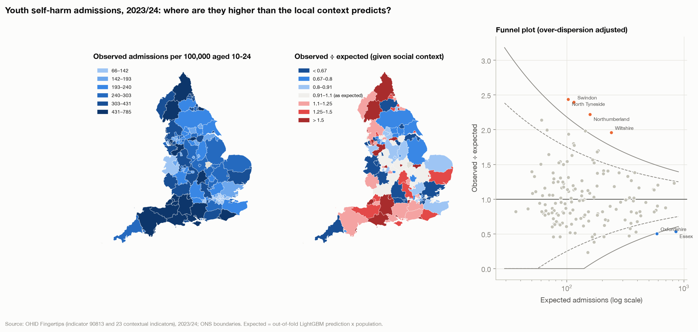
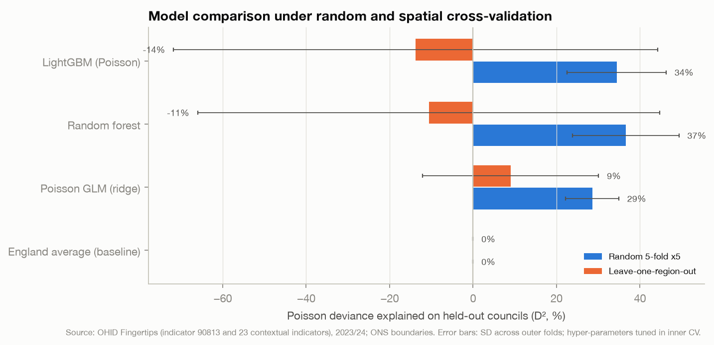
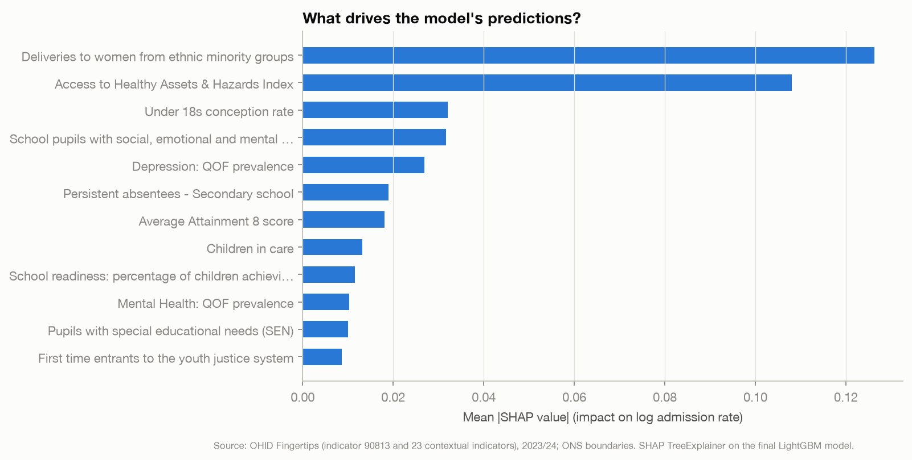
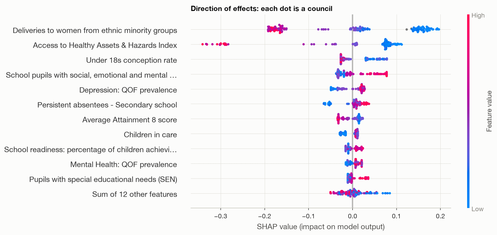
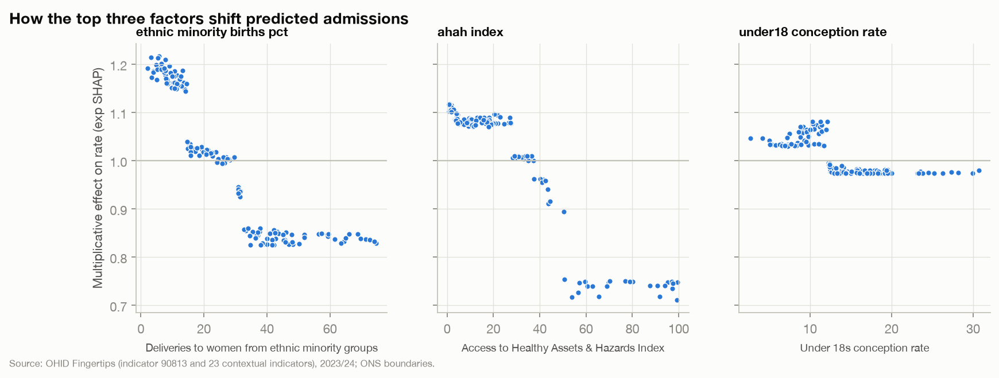
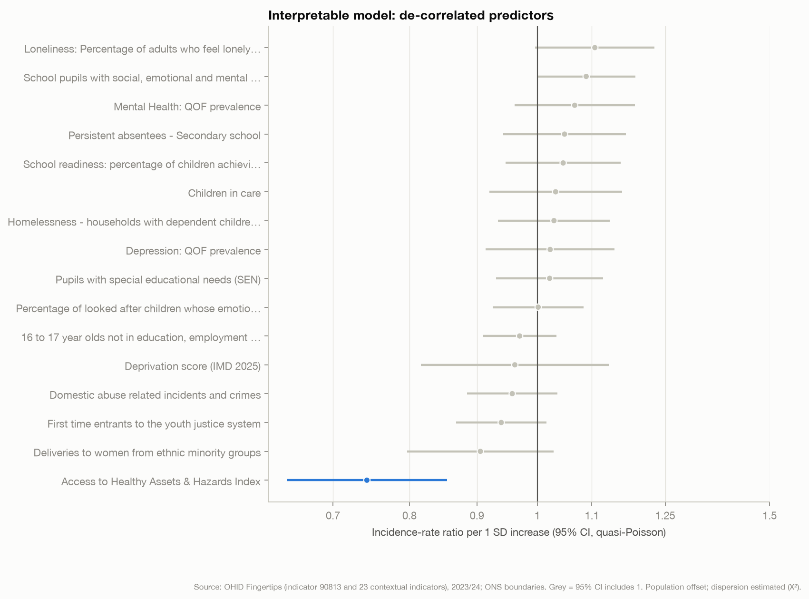
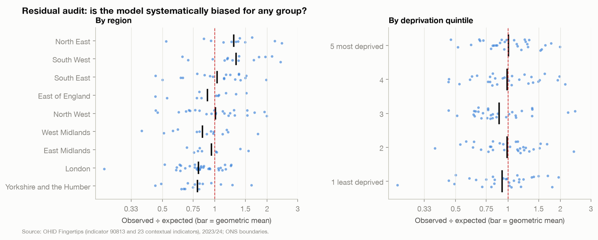

# Explaining Local Variation in Youth Self-Harm Hospital Admissions: An Honest ML Study

[](https://github.com/Abheetsbabbar/youth-self-harm-explainable-ml/actions/workflows/ci.yml)


> Hospital admissions for self-harm among 10–24 year olds vary **twelve-fold**
> between English councils, from 66 to 785 per 100,000. How much of that can be
> explained by the social context young people grow up in (poverty, care,
> schooling, family stress, community)? And which councils have **more admissions
> than their context predicts**? This project answers both questions with
> explainable machine learning, and stress-tests the answers with spatial and
> out-of-time validation.

Part 3 of a three-project portfolio on children and young people's mental health:

| # | Project | Question |
|---|---|---|
| 1 | [Access & inequalities](https://github.com/Abheetsbabbar/children-mental-health-access-inequalities) | Where, and for whom, is access to children's mental-health care unequal? |
| 2 | [Demand forecasting & waiting-list simulation](https://github.com/Abheetsbabbar/children-mental-health-demand-forecasting) | How many referrals are coming, and what capacity would clear the waiting list? |
| **3** | **Explainable self-harm risk model (this repo)** | Which local social factors explain youth self-harm admissions, and which areas exceed expectation? |

> ⚠️ **Area-level analysis only.** This model describes councils, not children.
> It must never be used to predict or screen individuals. See the
> [model card](docs/limitations_and_ethics.md).

---

## Key findings

| | Finding |
|---|---|
| 🎯 | With **random 5×5 nested cross-validation**, social-context models explain **29–37%** of the variation between councils (Poisson deviance; random forest 37%, LightGBM 34%, ridge GLM 29%; Spearman ρ ≈ 0.64). |
| 🧭 | **Spatial cross-validation tells a different story.** When a whole region is held out, the tree models fall **below the England-average baseline on deviance** (mean D² −11% to −14%) and the GLM keeps only **9%**. Results vary widely between regions (SD about 0.55 for the tree models), and their mean absolute error is still slightly better than the baseline's (104–105 vs 107 per 100k). The relationship does **not transfer reliably** between regions, so random CV overstates how well the model generalises. |
| 🗺️ | **Geography matters as much as social context.** Region alone explains **53%** of in-sample deviance, social context **51%** (a GLM using 16 de-correlated predictors of the 23), and both together **63%**. The residual audit confirms the model under-predicts the **North East (O/E 1.29)** and **South West (1.33)** and over-predicts London and Yorkshire (Kruskal–Wallis p = 0.0003). There is **no bias by deprivation quintile** (p = 0.47). |
| 🔎 | **Most important factors (SHAP):** population ethnic mix and the healthy-environment (AHAH) index, both markers of urban areas, are linked to **fewer** recorded admissions. Pupils with social, emotional and mental-health needs, adult depression prevalence, persistent secondary-school absence and children in care are linked to **more**. AHAH is a 2026 index, so it postdates the outcome, and these are associations, not causes. |
| 🏥 | After adjusting for context and over-dispersion (φ ≈ 15), **4 councils have significantly more admissions than expected**: North Tyneside, Swindon, Northumberland and Wiltshire (O/E 1.96–2.44). **2 have significantly fewer**: Oxfordshire and Essex (O/E ≈ 0.5). These are prompts for local investigation, such as service models, admission thresholds and recording, not verdicts. |
| ⏳ | **Out-of-time check:** a model trained on 2022/23 outcomes predicts 2023/24 with D² 0.32 (ρ 0.74). But last year's rate alone ranks councils better (ρ 0.92). Admission rates are very persistent, and local factors not captured here matter. |

<p align="center"></p>

<details>
<summary><b>More figures</b> (model comparison, SHAP, GLM, residual audit)</summary>







</details>

---

## Techniques and technologies

| Area | What was used | Where |
|---|---|---|
| **Data acquisition** | OHID **Fingertips REST API** (24 indicators, 153 councils); region lookup API; ONS ArcGIS boundaries | [`download.py`](src/selfharm_model/download.py) |
| **Feature engineering** | **Temporal alignment**: each predictor taken from the latest period on or before the target year, recorded in a feature catalogue; leakage control by excluding other hospital-admission outcomes; missingness threshold | [`build.py`](src/selfharm_model/build.py) |
| **Modelling** | Count-data framing: Poisson loss with population weights (≡ log-population offset); **ridge Poisson GLM**, **random forest**, **LightGBM (Poisson objective)**; England-average baseline | [`modelling.py`](src/selfharm_model/modelling.py) |
| **Validation** | **Nested cross-validation** (5×5 repeated outer, 3-fold inner grid search); **spatial leave-one-region-out CV**; **out-of-time validation**; metrics: Poisson deviance, D², weighted MAE, Spearman ρ | [`modelling.py`](src/selfharm_model/modelling.py) |
| **Explainability** | **SHAP** (TreeExplainer: importance, beeswarm, dependence); **quasi-Poisson GLM** incidence-rate ratios on a de-correlated subset chosen by **hierarchical correlation clustering** | [`analysis.py`](src/selfharm_model/analysis.py) |
| **Epidemiology** | **Observed/expected** ratios from out-of-fold predictions, **exact Poisson CIs**, over-dispersion-adjusted funnel plot; deviance decomposition (region vs context) | [`modelling.py`](src/selfharm_model/modelling.py) |
| **Responsible AI** | **Residual fairness audit** by region and deprivation (Kruskal–Wallis); **model card**; ecological-fallacy and use-restriction statements | [`docs/limitations_and_ethics.md`](docs/limitations_and_ethics.md) |
| **Geospatial** | GeoPandas choropleths with sequential and **diverging** (centred on O/E = 1) scales | [`analysis.py`](src/selfharm_model/analysis.py) |
| **Quality assurance** | **pytest** (metric identities, planted-signal recovery, no-future-data alignment); **pandera** contracts; **ruff**; **GitHub Actions CI** | [`tests/`](tests/) |

**Stack:** Python 3.11 · scikit-learn · LightGBM · SHAP · statsmodels · SciPy · pandas · GeoPandas · Matplotlib · pandera · pytest · ruff · GitHub Actions

---

## Repository structure

```
youth-self-harm-explainable-ml/
├── README.md
├── Makefile                       ← make all = download → build → analysis → test
├── pyproject.toml
├── src/selfharm_model/
│   ├── config.py                  ← target, 23 predictors (with rationale), CV settings
│   ├── download.py                ← Fingertips API, region lookup, ONS boundaries
│   ├── build.py                   ← time-aligned modelling tables + feature catalogue
│   ├── modelling.py               ← model zoo, nested & spatial CV, O/E, clustering
│   ├── analysis.py                ← SHAP, GLM, audits, out-of-time, figures, results.json
│   └── style.py
├── data/
│   ├── raw/                       ← downloads (git-ignored)
│   └── processed/                 ← modelling tables, feature catalogue, CV results, O/E (committed)
├── reports/
│   ├── figures/
│   └── results.json               ← every number quoted in this README
├── docs/
│   ├── methodology.md
│   ├── data_dictionary.md
│   ├── data_sources.md
│   └── limitations_and_ethics.md  ← model card
└── tests/
```

## How to run it

```bash
git clone https://github.com/Abheetsbabbar/youth-self-harm-explainable-ml.git
cd youth-self-harm-explainable-ml
python -m venv .venv && source .venv/bin/activate
make install
```

```bash
make all        # download → build → analysis (~3 min) → tests
```

On macOS, LightGBM needs OpenMP: `brew install libomp`.

## Documentation

- [Methodology](docs/methodology.md): target framing, temporal alignment, nested and spatial CV design, SHAP and GLM, O/E statistics
- [Data dictionary](docs/data_dictionary.md): every predictor, its source indicator and period
- [Data sources and licensing](docs/data_sources.md)
- [Model card, limitations and ethics](docs/limitations_and_ethics.md)

## Data and independence

The data is open and aggregate: no individual-level information is used. It
contains public sector information licensed under the
[Open Government Licence v3.0](https://www.nationalarchives.gov.uk/doc/open-government-licence/version/3/)
(OHID Fingertips; ONS). The target derives from Hospital Episode Statistics,
Copyright © NHS England. This is an independent portfolio project, not endorsed by
OHID, NHS England or any local authority.

*If this topic affects you: Samaritans 116 123 · Shout text 85258 · Childline 0800 1111 · Papyrus HOPELINE247 0800 068 4141.*

**Author:** Abheet Singh Babbar, MSc Data Science, University of Surrey
